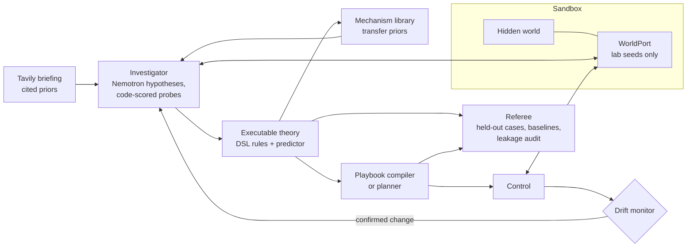

# LogicScout

**An AI that discovers how an unfamiliar system works, learns to operate it, and adapts when the rules change.**

[](https://github.com/shafir-01/LogicScout/actions/workflows/ci.yml)
[](LICENSE)
[](https://www.python.org/)

LogicScout is dropped in front of a system with no manual of its laws: only the names of its controls and readings. It designs experiments, proposes hypotheses, turns what survives into an **executable theory**, compiles a **playbook** that runs the system without calling the model each step, notices when the hidden laws silently change, re-investigates, and recovers. An independent **referee** then scores it on held-out cases the scout never saw.

## Try it

**Live: [logicscout.onrender.com](https://logicscout.onrender.com)** — pick a system (or "Unknown system", generated fresh for you), press **Start**, and watch it learn. The free instance sleeps when idle; the first load can take up to a minute.

Or run it locally in two commands (after setup below):

```bash
uv run python scripts/serve.py      # API + web UI on http://localhost:8787
uv run logicscout run --world relay --shift-after 10   # same mission, streamed in the terminal
```

In the web UI you pick a system and watch the run move through its phases: hypotheses proposed and refuted, probes stepping through the sandbox, theory revisions with prediction accuracy against a "nothing changes" baseline, the compiled playbook taking control, a **hidden change** (press the button or use `--shift-after`), the drift monitor raising suspicion then confirmation, re-investigation, recovery, and finally the referee report. After the run, a debrief reveals the true laws so you can compare them to what LogicScout learned.

## Features

- **Active investigation**: Nemotron proposes hypotheses; probes are designed to discriminate between them and scored in code, not by the model's opinion.
- **Executable theory**: rules written in a small, safe expression DSL (AST whitelist, no imports or attribute calls) that a predictor runs step by step, including memory and delayed effects.
- **Compiled playbooks**: a controller checked in simulation against the learned theory; falls back to a model-free lookahead planner on the theory.
- **Drift detection**: an evidence-based monitor (never a timer) flags prediction mismatches, confirms a hidden change, and triggers focused re-investigation.
- **Public-knowledge briefing**: Tavily search results become cited prior hypotheses that experiments confirm or overturn.
- **Mechanism library**: mechanisms learned in one world are offered as priors in another.
- **Independent referee**: held-out seeds and variants, baselines, and a leakage audit; the scout can never import it.
- **Logbook**: every event and model call is recorded with a verifiable digest chain and streamed live over SSE.

## How it works



1. **Encounter**: the scout reads the public manual (actions, fields, objectives, probe budget). It never sees the laws.
2. **Briefing** (optional): Tavily searches public material about this *kind* of system; one fast model call turns sources into testable priors with citations.
3. **Investigate**: hypotheses are written as DSL rules; probes run through the sandbox `WorldPort`, and each prediction is compared with what actually happened.
4. **Theory**: surviving rules form a theory; accuracy is reported next to the persistence baseline.
5. **Playbook**: the model compiles a controller, validated by simulation on the theory; the planner is the fallback.
6. **Control and drift**: the controller operates the world while the predictor keeps forecasting; repeated mismatches confirm a hidden change, and the investigator re-probes the implicated rules.
7. **Referee**: evaluates theory and playbook on held-out cases and audits for leakage.

Isolation is enforced in code and tested: `logicscout/scout`, `logicscout/llm` and `logicscout/briefing` must not import worlds or the referee (`tests/test_isolation.py`, plus the referee's `scout_imports_clean` audit).

## The worlds

| World | Title | Domain | What's hidden |
|---|---|---|---|
| `relay` | Maritime message relay | remote maritime communications | How each link's capacity, cost and reliability depend on conditions and past use |
| `rover` | Survey rover | robotics / field inspection (simulated) | How movement, terrain and energy interact |
| `orbit` | Orbit payload console | spacecraft operations | Undocumented command semantics and power/payload dependencies |
| `plant` | Water-treatment tank | industrial process control | How pump, valve, level and pressure respond to each other, including lags |
| `gate` | Field station job controller | remote device command API | A real HTTP service (own process) whose dispatch rules must be learned from responses |

| `forge` | Unknown system | generated | A new system composed from hidden mechanisms (delays, cooldowns, windows, capacities, lockouts) for every seed — nobody has seen it before |

Each world also has non-standard variants that the referee uses and the scout never meets in the lab.

## Models: NVIDIA Nemotron on Nebius Token Factory

All reasoning goes through `logicscout.llm.Nemotron`, an OpenAI-compatible client pointed at Nebius Token Factory (`https://api.tokenfactory.nebius.com/v1/`).

| Tier | Env var | Model | Used for |
|---|---|---|---|
| deep | `LS_MODEL_DEEP` | Nemotron 3 Ultra | theory building, playbook synthesis, harder reasoning |
| fast | `LS_MODEL_FAST` | Nemotron 3 Super (`nvidia/nemotron-3-super-120b-a12b`) | hypotheses, briefing priors, routine calls |

Calls request JSON output, strip `<think>` blocks, validate against a schema, and escalate fast to deep after repeated invalid output. Every call is logged as a `model.call` event with the real model id and latency. List available model ids with `uv run python -m logicscout.llm.models` and smoke-test with `uv run python -m logicscout.llm.smoke`. See [docs/models.md](docs/models.md) and [docs/nvidia-ecosystem.md](docs/nvidia-ecosystem.md).

**Tavily** (`POST https://api.tavily.com/search`, basic depth, at most 3 topics per run) supplies the briefing. Results are never treated as ground truth. See [docs/tavily.md](docs/tavily.md).

There are no mocked or cached model or search responses in the product path; if a key is missing, LogicScout fails with a clear message.

## Tech stack

- Python 3.12, [uv](https://docs.astral.sh/uv/), FastAPI, Uvicorn, Pydantic v2, httpx, OpenAI SDK
- React + TypeScript + Vite (`web/`)
- pytest + pytest-asyncio, GitHub Actions
- Docker; Hugging Face Spaces / Render / Nebius for hosting

## Getting started

**Prerequisites:** Python 3.12, [uv](https://docs.astral.sh/uv/), Node 22 (for the web UI), a Nebius Token Factory API key, and a Tavily API key (optional; use `--no-briefing` without it).

```bash
git clone https://github.com/shafir-01/LogicScout.git
cd LogicScout
uv sync
cp .env.example .env        # then fill in the keys
```

`.env` settings:

| Variable | Purpose |
|---|---|
| `NEBIUS_API_KEY` | Nebius Token Factory key (required) |
| `NEBIUS_BASE_URL` | defaults to `https://api.tokenfactory.nebius.com/v1/` |
| `LS_MODEL_DEEP` / `LS_MODEL_FAST` | Nemotron model ids for the deep and fast tiers |
| `TAVILY_API_KEY` | Tavily key for briefings |
| `LS_SANDBOX_URL` | empty = sandbox runs in-process; otherwise URL of the sandbox service |
| `LS_SANDBOX_TOKEN` | token for the sandbox service |
| `LS_GATE_URL` | gate world service, default `http://127.0.0.1:8790` |
| `LS_DATA_DIR` | where run logs are written, default `./data` |
| `LS_MAX_LIVE_RUNS` | concurrent live runs allowed by the server |

Build the web UI and start everything:

```bash
cd web && npm ci && npm run build && cd ..
uv run python scripts/serve.py
```

`scripts/serve.py` starts the gate service on `:8790` and the API on `$PORT` (default `8787`), which also serves `web/dist`. Open http://localhost:8787.

## Usage

### CLI

```bash
uv run logicscout worlds                                  # list worlds
uv run logicscout run --world relay --shift-after 10      # full mission, hidden change after 10 control steps
uv run logicscout run --world plant --no-briefing --budget 20
uv run logicscout run --world orbit --transfer --seed 8   # use mechanisms learned in earlier worlds
```

Options for `run`: `--world` (required), `--objective`, `--seed`, `--shift-after`, `--no-briefing`, `--transfer`, `--budget`. Each run writes `data/runs/<run_id>/events.jsonl` and `prompts.jsonl`.

### HTTP API

| Method | Path | Description |
|---|---|---|
| GET | `/api/health` | health check |
| GET | `/api/worlds` | public manuals of available worlds |
| POST | `/api/runs` | start a run (`RunConfig` body), returns `{run_id}` |
| GET | `/api/runs` | list runs |
| GET | `/api/runs/{id}` | run state |
| GET | `/api/runs/{id}/events` | Server-Sent Events: history replay, then live |
| POST | `/api/runs/{id}/shift` | apply a hidden change now |
| POST | `/api/runs/{id}/stop` | stop the run |
| GET | `/api/runs/{id}/debrief` | true laws and change records (only after the run finished) |
| GET | `/api/replays`, `/api/replays/{name}`, `/api/replays/{name}/events` | recorded runs |
| GET | `/api/infra` | infrastructure / model info |

```bash
curl -s localhost:8787/api/worlds
RUN=$(curl -s -X POST localhost:8787/api/runs -H 'content-type: application/json' \
  -d '{"world_id":"relay","use_briefing":true,"shift_after":10}' | python -c 'import sys,json;print(json.load(sys.stdin)["run_id"])')
curl -N localhost:8787/api/runs/$RUN/events
curl -s -X POST localhost:8787/api/runs/$RUN/shift
curl -s localhost:8787/api/runs/$RUN/debrief
```

`RunConfig` fields: `world_id`, `objective_id`, `seed`, `use_briefing`, `use_transfer`, `probe_budget`, `shift_after`.

## Project structure

```
logicscout/
  contracts.py     shared types (manual, actions, theory, playbook, events, ...)
  dsl.py           safe rule expression language
  theory.py        predictor, accuracy, persistence baseline, theory diff
  playbook.py      playbook runner, validation, simulation
  planner.py       model-free lookahead planner on the learned theory
  logbook.py       event log with digest chain and SSE subscribers
  scout/           investigator, mission loop, playbook synthesis, drift monitor, transfer
  llm/             Nemotron client (Nebius), model listing, smoke test
  briefing/        Tavily client and prior extraction
  sandbox/         session + WorldPort, optional HTTP sandbox service
  worlds/          hidden worlds (private to sandbox and referee)
  referee/         held-out evaluation and leakage audit
  bench/           matched-budget comparison arms
  server/          FastAPI app
  cli.py           `logicscout` command
web/               React + Vite UI
scripts/           serve.py (gate + API), start.sh (container entry)
deploy/            Hugging Face and Nebius notes
docs/              models, Tavily, evaluation protocol, deployment
tests/             pytest suite
```

## Evaluation

The full protocol, written before any results were collected, is in [docs/evaluation.md](docs/evaluation.md):

- **Referee** builds fresh worlds for held-out cases (seeds outside the lab range and variants the scout never met), runs the compiled controller, and checks success against the world's ground truth.
- **Prediction accuracy** is measured on transitions the scout cannot influence, next to the "nothing changes" baseline.
- **Baselines** (random, idle) run on the same cases.
- **Bench arms** with matched budgets: full, random probing, passive learning, zero-shot model control, prompt-only control, no briefing, no transfer, no adaptation.
- **Leakage audit**: no law text in prompts, clean scout imports, referee cases unseen, logbook digest verifies. Missing inputs are recorded as unverified failures, never silent passes.

```bash
uv run python -m logicscout.bench --world relay --seeds 2 --dry-run   # plan and call estimate
uv run python -m logicscout.bench --world relay --seeds 2             # real model calls
```

Results are written to `docs/results.md` (raw per-seed JSON in `data/bench/`) and reported as-is.

### Results so far (relay, objective `bulk8`, 2 seeds, live Nemotron)

| Arm | Held-out goal success | Prediction accuracy vs. "nothing changes" | Model calls |
|---|---|---|---|
| **Full LogicScout** | 0.50 / 0.25 | 0.90 / 0.89 vs. 0.76 | 23 / 22 |
| Random probing, same budget | 0.00 / 0.00 | 0.76 vs. 0.76 | 4 |
| Zero-shot model control* | 0.00 / 0.00 | n/a | 36 |
| Per-step model reasoning* | 0.00 / 0.00 | n/a | 36 |
| No adaptation (drift monitor off) | 0.00 / 0.00 | 0.88–0.89 vs. 0.76 | 14 |
| Code-side induction only, no model | 0.50 / 0.25 | 0.91 / 0.90 vs. 0.76 | 0 |

\*Capped subset of cases. Random and idle baselines scored 0.00 on every case, and every leakage check passed. Two honest readings: only the learn-a-theory-then-compile pipeline reaches the goal at all, and on this world the code-side rule fitting alone matched the model-assisted run — the model's share of the win is not separable here. Drift was detected and recovered on one of two seeds. See [docs/results.md](docs/results.md).

## Testing

```bash
uv run pytest -q
cd web && npx tsc --noEmit && npm run build
```

CI runs both on every push and pull request. Tests use `Fake*` doubles only under `tests/`.

## Deployment

See [docs/deploy.md](docs/deploy.md).

- **Docker**: `docker build -t logicscout . && docker run -p 8787:8787 --env-file .env logicscout`
- **Render** (live demo): free web service built from the `Dockerfile`, auto-deploys on push
- **Hugging Face Spaces** (Docker Space, port 7860): see [deploy/hf/README.md](deploy/hf/README.md)
- **Render**: Blueprint from `render.yaml`
- **Nebius**: see [deploy/nebius/README.md](deploy/nebius/README.md)

## Limitations and roadmap

- Worlds are compact simulations (plus one real HTTP service); real plants and devices are larger and noisier.
- The DSL covers arithmetic, comparisons and simple memory/delays; richer dynamics may not be expressible.
- Investigation quality depends on the model and probe budget; a run can end with an incomplete theory, and the referee reports that honestly.
- Drift detection needs enough mismatching evidence, so very subtle changes can be detected late.
- Planned: more worlds, richer mechanism transfer across domains, and longer multi-change runs.

## Contributing

Issues and pull requests are welcome. Keep `uv run pytest -q` green, put tests in `tests/test_<area>_*.py`, and never let scout, LLM or briefing code import worlds or the referee.

## License

[MIT](LICENSE)

## Author

shafir-01
