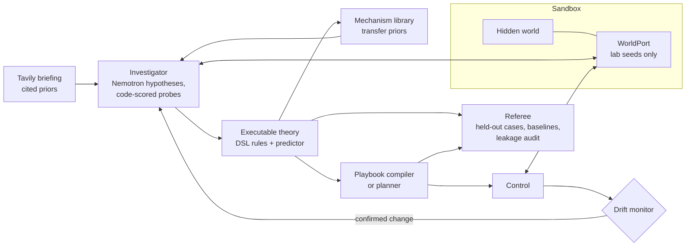

# LogicScout

**An AI scout that runs experiments on a system it has no manual for, writes executable rules that reproduce how it behaves, compiles a controller from them, and watches for the moment those rules stop holding.**

[](https://github.com/shafir-01/LogicScout/actions/workflows/ci.yml)
[](LICENSE)
[](https://www.python.org/)

LogicScout is placed in front of a system whose laws are never written down for it, so all it receives are the names of the controls, the names of the readings and a goal. From there it designs experiments and proposes hypotheses, turns whatever survives into an **executable theory**, and compiles a **playbook** that runs the system without calling the model at each step, while it keeps watching for the moment the hidden laws silently change so that it can investigate again and try to recover. Once the run is over, an independent **referee** scores the result on cases the scout never saw.

LogicScout learns rules that reproduce a system's behaviour across everything it has tested, keeps rival explanations open until evidence separates them, and proves every controller against a fresh copy of the real system before handing it control. [docs/limitations.md](docs/limitations.md) describes these design principles and how each one is measured.

## Try it

The live app runs at **[logicscout.onrender.com](https://logicscout.onrender.com)**, where you pick a system (or "Unknown system", which is generated fresh for you), press **Start** and watch it learn. Because the free instance sleeps when idle, the first load can take up to a minute. The app also includes a recording of a real live run with Nemotron on the relay world, published as `relay-live`, which you can replay without starting a run of your own.

Once the setup below is done you can also run it locally with two commands.

```bash
uv run python scripts/serve.py      # API + web UI on http://localhost:8787
uv run logicscout run --world relay --shift-after 10   # same mission, streamed in the terminal
```

In the web UI you pick a system and follow the run through its phases, as hypotheses are proposed and refuted, probes step through the sandbox and theory revisions report their prediction accuracy next to a "nothing changes" baseline. The compiled playbook then takes control until a **hidden change** arrives, which you trigger with the **Change the rules** button (choosing what changes) or with `--shift-after`, after which the drift monitor first raises suspicion and then confirms the change, the scout re-investigates and attempts to recover (which does not always succeed), and the referee report closes the run. A debrief afterwards reveals the true laws so that you can see where the learned rules match them by mechanism and where they only match by outcome, and during or after a run you can ask the theory a what-if question about a sequence of actions and then test that same sequence on the real system, as well as export the operating manual LogicScout wrote and a standalone `controller.py`.

## Features

Investigation is active rather than passive, because Nemotron proposes rival hypotheses while code designs each probe to discriminate between them and scores the outcome, so a hypothesis is never judged by the model's own opinion. The theory that results is executable, since its rules are written in a small expression DSL whose syntax tree is checked against a whitelist that forbids imports and attribute calls, which prevents generated rules from executing arbitrary code although it says nothing about whether the actions a controller takes are safe for the system, and a predictor runs those rules step by step with support for memory and delayed effects.

From that theory LogicScout compiles a playbook, which is a controller checked in simulation against the learned theory before it is used, a check that can only be as good as the theory itself, so before it takes control the playbook also runs a short reality trial on a separate session of the real system and is rejected when its real behaviour contradicts the simulation. When no compiled playbook passes, LogicScout falls back to a lookahead planner that searches the theory without any model calls, and when several rival theories still fit the evidence it plans for the worst case across them. Safety limits declared in a world's manual are checked on every real reading, and probes and control actions that the theory predicts would break them are not taken, a guard that is only as good as the theory, which is why every real breach is still logged. While the playbook operates, a drift monitor driven purely by evidence (never by a timer) flags prediction mismatches, confirms a hidden change once the evidence is strong enough and triggers a re-investigation focused on the implicated rules.

Public knowledge enters through a briefing in which Tavily search results become cited prior hypotheses that experiments then confirm or overturn, and a mechanism library carries mechanisms learned in one world over as priors for another. An independent referee evaluates the result on held out seeds and variants with baselines and a leakage audit, and the scout can never import it. Every event and model call is recorded in a logbook whose events are chained by sha256 digests and streamed live over SSE, and because the chain is kept locally it shows the integrity of that chain rather than protection against a party that controls the whole log, unless its final digest is anchored somewhere external, which is why the head of each finished run's chain is recorded in `data/anchors.jsonl` in the repository and can be checked with `logicscout verify`.

## How it works



A run begins with the encounter, in which the scout reads the public manual listing the actions, fields, objectives and probe budget, and it never sees the laws themselves. If briefing is enabled, Tavily then searches public material about this kind of system and a single fast model call turns the sources into testable priors that carry their citations. The investigation that follows writes hypotheses as DSL rules and runs probes through the sandbox `WorldPort`, comparing every prediction with what actually happened, so that the rules which survive form a theory whose accuracy is always reported next to the persistence baseline.

The model then compiles a playbook from that theory, which is validated by simulation on the theory and replaced by the planner when it fails. During control the playbook operates the world while the predictor keeps forecasting each step, and because repeated mismatches confirm a hidden change, the investigator is sent back to re-probe the rules that are implicated. At the end the referee evaluates both the theory and the playbook on held out cases and audits the run for leakage.

Isolation is a rule in the code that the tests check, because `logicscout/scout`, `logicscout/llm` and `logicscout/briefing` must not import the worlds or the referee, which `tests/test_isolation.py` verifies together with the referee's own `scout_imports_clean` audit. These are static checks on the source and a search of the prompt log rather than a process boundary, so they catch the obvious routes by which hidden laws could reach the model without proving that no route exists.

## The worlds

| World | Title | Domain | What's hidden |
|---|---|---|---|
| `relay` | Maritime message relay | remote maritime communications | How each link's capacity, cost and reliability depend on conditions and past use |
| `rover` | Survey rover | robotics / field inspection (simulated) | How movement, terrain and energy interact |
| `orbit` | Orbit payload console | spacecraft operations | Undocumented command semantics and power/payload dependencies |
| `plant` | Water-treatment tank | industrial process control | How pump, valve, level and pressure respond to each other, including lags |
| `gate` | Field station job controller | remote device command API | A real HTTP service (own process) whose dispatch rules must be learned from responses |
| `forge` | Unknown system | generated | A new combination, for every seed, of hidden mechanisms drawn from eight familiar families (delays, cooldowns, windows, capacities, lockouts and others) |

Each world also has variants beyond the standard one, which the referee uses and the scout never meets in the lab. Forge systems can be expressed in the rule language, since a theory written from the true rules predicts all 36 generated systems in the test suite with full accuracy, which shows that the DSL can represent them but not that the scout discovers them, while a random policy reaches the goal on only 3 of 72 referee cases. [docs/forge.md](docs/forge.md) describes how a seed composes its mechanisms.

## Models: NVIDIA Nemotron on Nebius Token Factory

All reasoning goes through `logicscout.llm.Nemotron`, a client for the OpenAI API format that points at Nebius Token Factory (`https://api.tokenfactory.nebius.com/v1/`).

| Tier | Env var | Model | Used for |
|---|---|---|---|
| deep | `LS_MODEL_DEEP` | Nemotron 3 Ultra (`nvidia/Nemotron-3-Ultra-550b-a55b`) | hypotheses, theory revision, playbook synthesis |
| fast | `LS_MODEL_FAST` | Nemotron 3 Super (`nvidia/nemotron-3-super-120b-a12b`) | probe design, briefing priors, mechanism transfer |

Every call requests JSON output, strips `<think>` blocks and validates the result against a schema, and a call that stops at the token limit is retried with a larger budget, while fast calls escalate to the deep tier after repeated invalid output. Each call is logged as a `model.call` event carrying the real model id returned by the API together with its latency. You can list the available model ids with `uv run python -m logicscout.llm.models` and run a smoke test with `uv run python -m logicscout.llm.smoke`, and the details are in [docs/models.md](docs/models.md) and [docs/nvidia-ecosystem.md](docs/nvidia-ecosystem.md).

**Tavily** supplies the briefing through `POST https://api.tavily.com/search` with advanced search depth and at most 3 topics per run, and its results are never treated as ground truth, as [docs/tavily.md](docs/tavily.md) explains.

The product path contains no mocked or cached model or search responses, so if a key is missing LogicScout stops with a clear message instead of pretending.

## Tech stack

The backend is written in Python 3.12 and managed with [uv](https://docs.astral.sh/uv/), using FastAPI and Uvicorn for the server, Pydantic v2 for the shared types, httpx for HTTP and the OpenAI SDK for model calls. The interface in `web/` is built with React, TypeScript and Vite. Tests run on pytest with pytest-asyncio under GitHub Actions, and the app ships as a Docker image that can be hosted on Render, Hugging Face Spaces or Nebius.

## Getting started

You will need Python 3.12, [uv](https://docs.astral.sh/uv/), Node 22 for the web UI, a Nebius Token Factory API key and, optionally, a Tavily API key, since without one you can run with `--no-briefing`.

```bash
git clone https://github.com/shafir-01/LogicScout.git
cd LogicScout
uv sync
cp .env.example .env        # then fill in the keys
```

The settings in `.env` are listed below.

| Variable | Purpose |
|---|---|
| `NEBIUS_API_KEY` | Nebius Token Factory key (required) |
| `NEBIUS_BASE_URL` | defaults to `https://api.tokenfactory.nebius.com/v1/` |
| `LS_MODEL_DEEP` / `LS_MODEL_FAST` | Nemotron model ids for the deep and fast tiers |
| `TAVILY_API_KEY` | Tavily key for briefings |
| `LS_SANDBOX_URL` | empty = sandbox runs in-process; otherwise URL of the sandbox service |
| `LS_SANDBOX_TOKEN` | token for the sandbox service |
| `LS_GATE_URL` | gate world service, default `http://127.0.0.1:8790` |
| `LS_DATA_DIR` | where run logs are written, default `./data` |
| `LS_MAX_LIVE_RUNS` | concurrent live runs allowed by the server |

Then build the web UI and start everything.

```bash
cd web && npm ci && npm run build && cd ..
uv run python scripts/serve.py
```

`scripts/serve.py` starts the gate service on `:8790` and the API on `$PORT` (default `8787`), and the API also serves `web/dist`, so you can open http://localhost:8787 once both are up.

## Usage

### CLI

```bash
uv run logicscout worlds                                  # list worlds
uv run logicscout run --world relay --shift-after 10      # full mission, hidden change after 10 control steps
uv run logicscout run --world plant --no-briefing --budget 20
uv run logicscout run --world orbit --transfer --seed 8   # use mechanisms learned in earlier worlds
```

The `run` command requires `--world` and also accepts `--objective`, `--seed`, `--shift-after`, `--no-briefing`, `--transfer` and `--budget`, and every run writes its events to `data/runs/<run_id>/events.jsonl` and its prompts to `prompts.jsonl` in the same folder.

### HTTP API

| Method | Path | Description |
|---|---|---|
| GET | `/api/health` | health check |
| GET | `/api/worlds` | public manuals of available worlds |
| GET | `/api/worlds/{id}/shifts` | menu of hidden changes you can choose for a world |
| GET | `/api/forge/new` | a freshly generated unknown system (variant and manual) |
| POST | `/api/runs` | start a run (`RunConfig` body), returns `{run_id}` |
| GET | `/api/runs` | list runs |
| GET | `/api/runs/{id}` | run state |
| GET | `/api/runs/{id}/events` | Server-Sent Events: history replay, then live |
| POST | `/api/runs/{id}/shift` | apply a hidden change now (optional body `{"kind": ...}`) |
| POST | `/api/runs/{id}/stop` | stop the run |
| POST | `/api/runs/{id}/whatif` | predict a sequence of actions with the theory, then test it |
| GET | `/api/runs/{id}/export/manual.md`, `/api/runs/{id}/export/controller.py` | operating manual and standalone controller |
| GET | `/api/runs/{id}/debrief` | true laws and change records (only after the run finished) |
| GET | `/api/replays`, `/api/replays/{name}`, `/api/replays/{name}/events` | recorded runs |
| GET | `/api/infra` | infrastructure / model info |

```bash
curl -s localhost:8787/api/worlds
RUN=$(curl -s -X POST localhost:8787/api/runs -H 'content-type: application/json' \
  -d '{"world_id":"relay","use_briefing":true,"shift_after":10}' | python -c 'import sys,json;print(json.load(sys.stdin)["run_id"])')
curl -N localhost:8787/api/runs/$RUN/events
curl -s -X POST localhost:8787/api/runs/$RUN/shift
curl -s localhost:8787/api/runs/$RUN/debrief
```

A `RunConfig` body accepts `world_id`, `objective_id`, `seed`, `use_briefing`, `use_transfer`, `probe_budget` and `shift_after`.

## Project structure

```
logicscout/
  contracts.py     shared types (manual, actions, theory, playbook, events, ...)
  dsl.py           sandboxed rule expression language (no imports or attribute calls)
  theory.py        predictor, accuracy, persistence baseline, theory diff
  playbook.py      playbook runner, validation, simulation
  planner.py       model-free lookahead planner on the learned theory
  logbook.py       event log with digest chain and SSE subscribers
  scout/           investigator, mission loop, playbook synthesis, drift monitor, transfer
  llm/             Nemotron client (Nebius), model listing, smoke test
  briefing/        Tavily client and prior extraction
  sandbox/         session + WorldPort, optional HTTP sandbox service
  worlds/          hidden worlds (private to sandbox and referee)
  referee/         held-out evaluation and leakage audit
  bench/           matched-budget comparison arms
  server/          FastAPI app
  cli.py           `logicscout` command
web/               React + Vite UI
scripts/           serve.py (gate + API), start.sh (container entry)
deploy/            Hugging Face and Nebius notes
docs/              models, Tavily, evaluation protocol, results, limitations, deployment
tests/             pytest suite
```

## Evaluation

Every result comes from an independent referee that the scout cannot import. It builds fresh worlds from seeds outside the lab range and from variants the scout never met, runs the compiled controller on them and checks success against each world's ground truth, while the random, idle and tabular baselines run on exactly the same cases. Beyond plain prediction accuracy the referee reports accuracy on the readings that actually change, open loop accuracy up to five steps ahead and accuracy on the readings the goal depends on, and every run passes a leakage audit proving that no hidden law reached a prompt and that every referee case stayed unseen. The protocol was fixed before any results were collected and lives in [docs/evaluation.md](docs/evaluation.md).

```bash
uv run python -m logicscout.bench --world relay --seeds 2 --dry-run   # plan and call estimate
uv run python -m logicscout.bench --world relay --seeds 2             # real model calls
```

### Held-out goal success at scale (Wilson 95% intervals)

| World | Held-out cases | LogicScout | Tabular model | Random | Idle |
|---|---|---|---|---|---|
| Forge, 100 generated systems | 600 | **123/600 = 0.20** [0.17, 0.24] | 0/600 | 16/600 = 0.03 | 0/600 |
| relay `bulk8`, 8 seeds | 32 | **4/32 = 0.12** [0.05, 0.28] | 0/32 | 0/32 | 0/32 |

Across one hundred systems that did not exist before the run, the scout turns experiments into a working controller on a fifth of unseen cases, where a classical table model built from the same experience never succeeds and random play almost never does. On the relay its learned theory predicts 88 to 91 percent of transitions against 76 percent for the nothing changes baseline, and the live recording `relay-recovery` shows the whole loop on Nemotron, from first contact through control to a secret rule change that it detects, investigates and recovers from before reaching the goal again.

### Live benchmark on Nemotron (relay, 2 seeds)

| Arm | Held-out goal success | Prediction accuracy vs. "nothing changes" |
|---|---|---|
| **Full LogicScout** | **0.50 / 0.25** | **0.90 / 0.89** vs. 0.76 |
| Random probing, same budget | 0.00 / 0.00 | 0.76 vs. 0.76 |
| Zero-shot model control | 0.00 / 0.00 | n/a |
| Per-step model reasoning | 0.00 / 0.00 | n/a |
| No adaptation (drift monitor off) | 0.00 / 0.00 | 0.88 vs. 0.76 |

Asking a model to act at every step never reached the goal, while learning executable rules and compiling them into a controller did, which is the central design choice of LogicScout. Change detection was rebuilt around rules that have earned trust during control and now confirms abrupt changes in 8 of 10 runs and gradual drift in 12 of 13, with false alarms reduced to a quarter, as measured in [docs/drift.md](docs/drift.md). Every row, seed and raw JSON file is in [docs/results.md](docs/results.md) and `data/bench/`.

## Testing

```bash
uv run pytest -q
cd web && npx tsc --noEmit && npm run build
```

CI runs both on every push and pull request, and test doubles named `Fake*` exist only under `tests/`.

## Deployment

The full guide is in [docs/deploy.md](docs/deploy.md), and the supported targets are summarized below.

| Target | How |
|---|---|
| Docker | `docker build -t logicscout . && docker run -p 8787:8787 --env-file .env logicscout` |
| Render (live demo) | free web service built from the `Dockerfile`, deployed automatically on push, or as a Blueprint from `render.yaml` |
| Hugging Face Spaces | Docker Space on port 7860, see [deploy/hf/README.md](deploy/hf/README.md) |
| Nebius | see [deploy/nebius/README.md](deploy/nebius/README.md) |

## Roadmap

LogicScout is designed to reach real equipment through the same four call port it uses today, so the next steps are device interfaces, test benches and industrial simulators, richer rule shapes for continuous and stochastic dynamics, transfer of learned mechanisms between structurally different machines, and longer runs with several changes in sequence. The design principles and the measurement behind each capability are described in [docs/limitations.md](docs/limitations.md).

## Contributing

Issues and pull requests are welcome, as long as `uv run pytest -q` stays green, new tests go in `tests/test_<area>_*.py`, and scout, LLM and briefing code never imports the worlds or the referee.

## License

[MIT](LICENSE)

## Author

shafir-01
