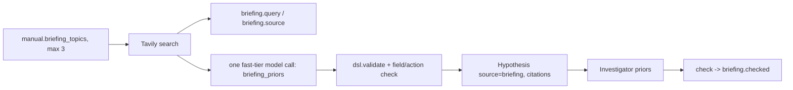

# Tavily briefing: public knowledge vs. learned reality

Before experimenting, LogicScout reads public documentation about the *kind* of system it faces and turns
attributed claims into formal, testable prior hypotheses (`source="briefing"`, with citation URLs). Experiments then
confirm or overturn them. Search results are never ground truth: a prior is a tentative rule, scored by probes like any other.

## API used (verified against https://docs.tavily.com/documentation/api-reference/endpoint/search)

- `POST https://api.tavily.com/search`, header `Authorization: Bearer <TAVILY_API_KEY>`, JSON body.
- Request: `query` (required), `search_depth` (`basic` = 1 credit, `advanced` = 2, also `fast`/`ultra-fast`),
  `max_results` (0-20), `topic` (`general|news|finance`), `time_range` (`day|week|month|year`),
  `include_answer`, `include_raw_content`, `include_published_date`, `include_usage`.
- Response: `results[]` with `url`, `title`, `content`, `score`, `published_date` (only if `include_published_date`),
  plus `response_time`, `usage.credits`, `request_id`.
- Errors: 401 bad key, 422 invalid, 429 rate limit (`Retry-After`), 432/433 plan limits. 429/5xx/network errors are retried; the rest fail fast.
- `brief()` searches with `search_depth=advanced` (2 credits/call), `exclude_domains` = dictionary sites (merriam-webster, dictionary.com,
  wiktionary, collinsdictionary, thefreedictionary, vocabulary.com, ...), and also drops results whose title looks like a definition page.
  At most 3 topics per run (6 credits). Topics are specific technical questions per world (`manual.briefing_topics`).

## Flow

Safety: queries come only from `manual.briefing_topics` (generic domain topics). World ids, the product name, and
anything hidden never enter a query. Claims with no valid source index, a `quote` that is not found verbatim in a cited excerpt, unknown actions or fields, or invalid DSL are dropped (logged as `note`). Each kept claim carries citations `{url, title, published_date}` and its quoted evidence (<= 200 chars) in `briefing.claim`.

## Interface

- `TavilyClient(api_key=None).search(query, **params) -> list[Source]`; raises `TavilyError` if `TAVILY_API_KEY` is unset.
  `stats()` -> `{calls, failed, results, credits, latency_ms_avg/p50/max}` for the infra panel.
- `brief(manual, llm, log, max_sources=6, client=None) -> list[Hypothesis]`
- `assess(hyps, transitions)`: verdict from data. Each claim's rule runs alone in a `Predictor` over the scout's real transitions;
  on steps where it fires, its effect fields are compared with what was observed. `confirmed`: fired >= 2 and >= 90% field agreement;
  `contradicted`: fired and < 50% agreement, with `counterexample` "public docs predict X; observed Y at t=..."; else `untested`.
  Rows: `{claim, status, citations, evidence, rule_id, fired, agreement[, counterexample]}`.
- `check(hyps, theory, transitions=None)`: uses `assess` when transitions are given, else falls back to hypothesis/theory rule status.
  The mission logs the result as `briefing.checked`.

## Ablation protocol: `run_briefing_ablation(...)` (implemented by the bench owner)

Run the identical mission twice per seed, differing only in `RunConfig.use_briefing`:

| arm | use_briefing | everything else |
|---|---|---|
| A | True | same world, objective, seed, probe budget, models |
| B | False | same |

Use N >= 3 seeds. Metrics per arm, reported as mean and per-seed values:

1. **Probes to competence**: probe steps until the theory first reaches a fixed held-in accuracy threshold (e.g. 0.9, above the persistence baseline).
2. **Final referee success rate** and theory prediction accuracy on held-out cases.
3. **Prior outcomes** (arm A only): counts of confirmed, contradicted, untested from `briefing.checked`. Contradicted priors are the headline: the scout was handed a public claim and the experiments overturned it.
4. **Cost**: Tavily calls, credits, latency from `TavilyClient.stats()`.

Report honestly: if briefing does not reduce probes-to-competence, say so; the contradicted-prior count still shows that public knowledge was tested rather than trusted.

## Live check (2026-10-30, real Tavily + Nemotron fast tier, `brief()` only, no mission)

6 searches (advanced), 12 credits, avg latency 2.9 s (orbit) / 3.3 s (relay). No dictionary pages came back. 5 claims per world survived;
every quote was verified verbatim against the cited excerpt.

**orbit** sources: NASA ESSP *Hosted Payload Interface Guide for Proposers* (essp.nasa.gov PDF, published 2020-11-04, and the larc.nasa.gov copy);
Satellogic *Pushing Intelligence to the Edge* (2025-03-20); Nature Sci. Rep. *STTORM-CD ... onboard satellites* (2026-02-04);
STScI *HST STIS 7.2 The CCD*; Cloudy Nights forum *CCD temp questions*.

| claim | rule | evidence (quote) |
|---|---|---|
| Bus power must be on before payload power can be switched on | power payload on when not bus_on -> payload_on stays False | "When in INITIALIZATION mode, the command and telemetry functions of the Instrument should be powered up first." (NASA HPIG) |
| Payload cannot capture unless powered | capture when not payload_on -> fault | same NASA HPIG sentence |
| Calibration only when payload is on | calibrate when not payload_on -> fault | same |
| Heater must be on to reach operating temperature | * when t > 10 -> heater_on True | "...the Instrument should conduct Instrument component warm-up or cool-down to operating temperatures." (NASA HPIG) |
| Downlink requires a valid stored image | downlink when valid_stored < 1 -> fault | "...maintaining a rolling archive of recent captures..." (Satellogic) |

**relay** sources: WSO2 *Implementing Store and Forward Messaging Patterns* (2011-11-02); GeeksforGeeks *Message Queues - System Design* (2023-11-24);
MDPI Sensors *Enhanced Communications on Satellite-Based IoT*; Scientech *Satellite Communication* (2026-10-15);
MDPI JMSE *A Low-Cost Autonomous Multi-Functional Buoy* (2025-09-01); OOI *DEOS Moored Buoy Observatory Design Study*.

| claim | rule | evidence (quote) |
|---|---|---|
| Sending via sat forwards up to n messages | send via sat -> queue -n, delivered +n | "The message producer creates a message and sends it to the message queue." (GfG) |
| Buoy sends depend on buoy signal | send via buoy -> delivered only if buoy_signal > 0, else lost | "...six 12 V, 150 mA photovoltaic cells coupled with a 10 Ah sealed lead acid battery." (MDPI buoy) |
| Priority messages wait for prioritize | send with priority_waiting > 0 -> queues unchanged | "Message consumers retrieve messages from the queue when they are ready to process them." (GfG) |
| Each send consumes energy proportional to n | send -> vessel_energy - n | "...TPL5110 power timer to adjust the duty cycle, the daily energy consumption was reduced to approximately 13.7 Wh." (MDPI buoy) |
| Buoy with no signal loses messages | send via buoy, buoy_signal <= 0 -> lost + n | "...system voltages were maintained above 11.7 V..." (MDPI buoy) |

Honest reading: sources are now on-topic and every claim is traceable to a real sentence, but the orbit power-sequencing claims are
the only ones a quote directly states; several relay quotes only touch the topic. After this run the prompt was tightened to require that
the quote by itself states the norm (fewer claims preferred over weak ones); not re-run to stay within the test budget.
Whether each prior holds in a world is decided by `assess()` on the scout's own transitions, not by the source.
