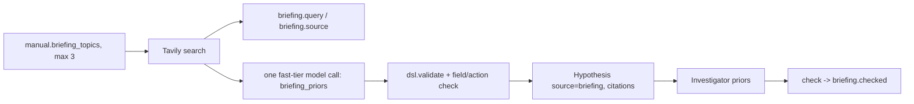

# Tavily briefing: public knowledge vs. learned reality

Before experimenting, LogicScout reads public documentation about the *kind* of system it faces and turns
attributed claims into formal, testable prior hypotheses (`source="briefing"`, with citation URLs). Experiments then
confirm or overturn them. Search results are never ground truth: a prior is a tentative rule, scored by probes like any other.

## API used (verified against https://docs.tavily.com/documentation/api-reference/endpoint/search)

- `POST https://api.tavily.com/search`, header `Authorization: Bearer <TAVILY_API_KEY>`, JSON body.
- Request: `query` (required), `search_depth` (`basic` = 1 credit, `advanced` = 2, also `fast`/`ultra-fast`),
  `max_results` (0-20), `topic` (`general|news|finance`), `time_range` (`day|week|month|year`),
  `include_answer`, `include_raw_content`, `include_published_date`, `include_usage`.
- Response: `results[]` with `url`, `title`, `content`, `score`, `published_date` (only if `include_published_date`),
  plus `response_time`, `usage.credits`, `request_id`.
- Errors: 401 bad key, 422 invalid, 429 rate limit (`Retry-After`), 432/433 plan limits. 429/5xx/network errors are retried; the rest fail fast.
- The client uses `search_depth=basic` (1 credit/call, free tier), at most 3 topics per run.

## Flow



Safety: queries come only from `manual.briefing_topics` (generic domain topics). World ids, the product name, and
anything hidden never enter a query. Claims with no supporting source, unknown actions or fields, or invalid DSL are dropped (logged as `note`).

## Interface

- `TavilyClient(api_key=None).search(query, **params) -> list[Source]`; raises `TavilyError` if `TAVILY_API_KEY` is unset.
  `stats()` -> `{calls, failed, results, credits, latency_ms_avg/p50/max}` for the infra panel.
- `brief(manual, llm, log, max_sources=6, client=None) -> list[Hypothesis]`
- `check(hyps, theory) -> [{claim, status: confirmed|contradicted|untested, citations, rule_id}]`. The mission logs the result as `briefing.checked`.

## Ablation protocol: `run_briefing_ablation(...)` (implemented by the bench owner)

Run the identical mission twice per seed, differing only in `RunConfig.use_briefing`:

| arm | use_briefing | everything else |
|---|---|---|
| A | True | same world, objective, seed, probe budget, models |
| B | False | same |

Use N >= 3 seeds. Metrics per arm, reported as mean and per-seed values:

1. **Probes to competence**: probe steps until the theory first reaches a fixed held-in accuracy threshold (e.g. 0.9, above the persistence baseline).
2. **Final referee success rate** and theory prediction accuracy on held-out cases.
3. **Prior outcomes** (arm A only): counts of confirmed, contradicted, untested from `briefing.checked`. Contradicted priors are the headline: the scout was handed a public claim and the experiments overturned it.
4. **Cost**: Tavily calls, credits, latency from `TavilyClient.stats()`.

Report honestly: if briefing does not reduce probes-to-competence, say so; the contradicted-prior count still shows that public knowledge was tested rather than trusted.

## Live check

No `TAVILY_API_KEY` was present in `.env` when this was written, so no live call has been recorded yet.
Once the key is set, run:

```
uv run python -c "import asyncio; from logicscout.briefing import TavilyClient; c=TavilyClient(); r=asyncio.run(c.search('how message queues behave when full', max_results=5)); print(len(r), c.stats())"
```

and paste the latency and result count here.
